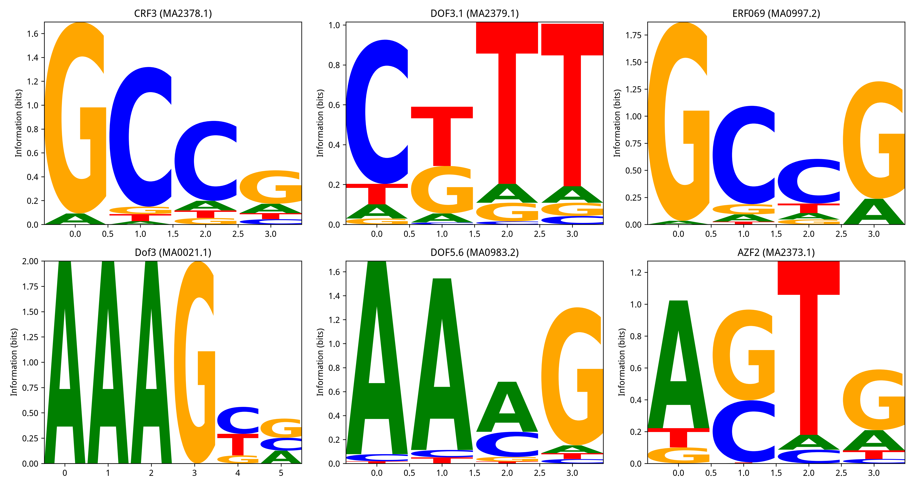

# Motif 挖掘分析

## 1. 分析目的

用 Integrated Gradients (IG) 对训练好的模型做解释，找出影响互作预测的关键序列位置，再和 JASPAR 植物 TF 基序数据库比对，识别模型学到的转录因子结合位点。

## 2. 方法

- **模型解释**：Captum 的 Integrated Gradients，对 500 个高置信度正样本计算每个碱基位置的归因分数。
- **Motif 提取**：对每个样本，找 IG 贡献最高的 20 bp 窗口。
- **JASPAR 比对**：用 PWM log-odds 打分，找最匹配的植物 TF motif。

## 3. 主要结果

Top 20 富集的 TF motif：

| Motif | 出现次数 | 家族 |
|:---|:---|:---|
| CRF3 | 24 | AP2/ERF |
| DOF3.1 | 24 | DOF |
| PK16340.1 | 20 | — |
| ERF069 | 18 | AP2/ERF |
| Dof3 | 18 | DOF |
| DOF5.6 | 17 | DOF |
| AZF2 | 17 | C2H2 |
| DOF2.4 | 16 | DOF |
| PK01144.1 | 16 | — |
| GATA4 | 14 | GATA |
| DOF5.3 | 14 | DOF |
| PpDof6 | 12 | DOF |
| TREE1 | 11 | AP2/ERF |
| ERF094 | 9 | AP2/ERF |

## 4. 生物学意义

**DOF 家族高度富集**（Top 20 中有 6 个成员）。DOF 是植物特有的转录因子家族，在种子发育、碳氮代谢、含油量调控中起关键作用。

**AP2/ERF 家族也很突出**（CRF3、ERF069、TREE1、ERF094）。其中 WRI1（AP2/ERF 家族）是油脂合成的主控因子，直接调控多个脂肪酸合成基因。

**结论**：模型学到的序列特征，和已知的、调控种子含油量的转录因子结合位点高度一致。这为模型预测的生物学意义提供了直接证据。

## 5. 结果图

