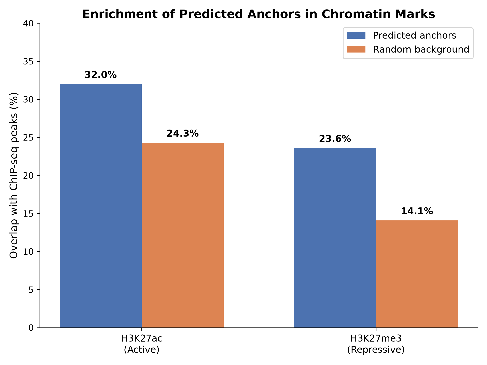

# 结果汇总

## 1. 数据统计

| 项目 | 数值 |
|:---|:---|
| Hi-C 互作对（原始） | 159,675 |
| OCR 区域 | 120,324 |
| 锚点落在 OCR 上（anchor1） | 75.3% |
| 锚点落在 OCR 上（anchor2） | 75.7% |

## 2. 正负样本

| 样本类型 | 数量 |
|:---|:---|
| 正样本（原始） | 159,675 |
| 正样本（过滤后） | 150,115 |
| 负样本（原始） | 159,954 |
| 负样本（过滤后） | 159,503 |

## 3. 模型训练

| 指标 | 数值 |
|:---|:---|
| 训练集 | 216,732 |
| 验证集 | 30,962 |
| 测试集 | 61,924 |
| 训练 Acc | 99.90% |
| 验证 Acc | 96.61% |
| 最佳验证 Acc | 96.87%（第 148 epoch） |

## 4. 测试集评估

| 指标 | 数值 |
|:---|:---|
| AUC | 0.9942 |
| AUPR | 0.9934 |
| Precision | 95.84% |
| Recall | 97.55% |
| F1 | 96.69% |

## 5. 生物学验证

| 标记 | 预测锚点重叠 | 随机背景重叠 | 富集倍数 | p-value |
|:---|:---|:---|:---|:---|
| H3K27ac（活跃） | 32.0% | 24.3% | 1.32 | < 0.001 |
| H3K27me3（抑制） | 23.6% | 14.1% | 1.67 | < 0.001 |

